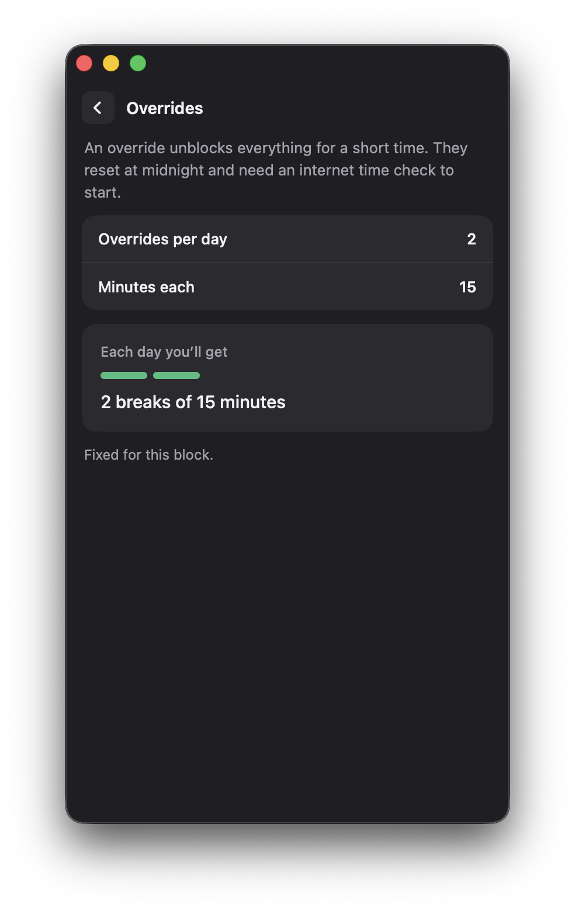
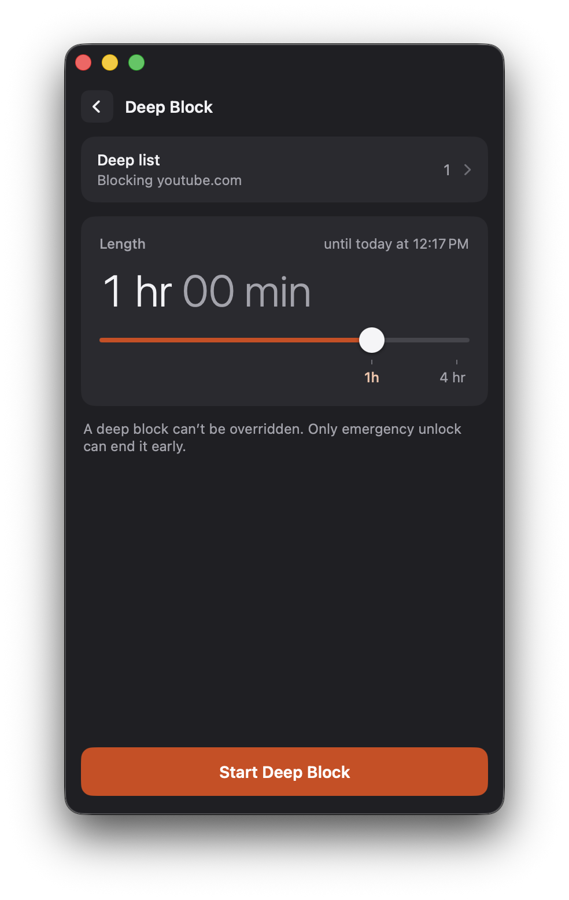
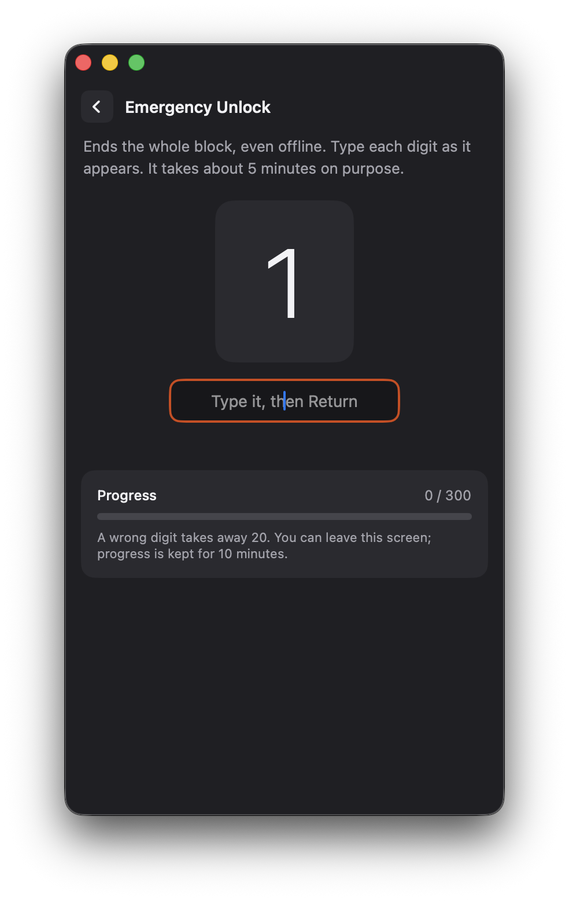
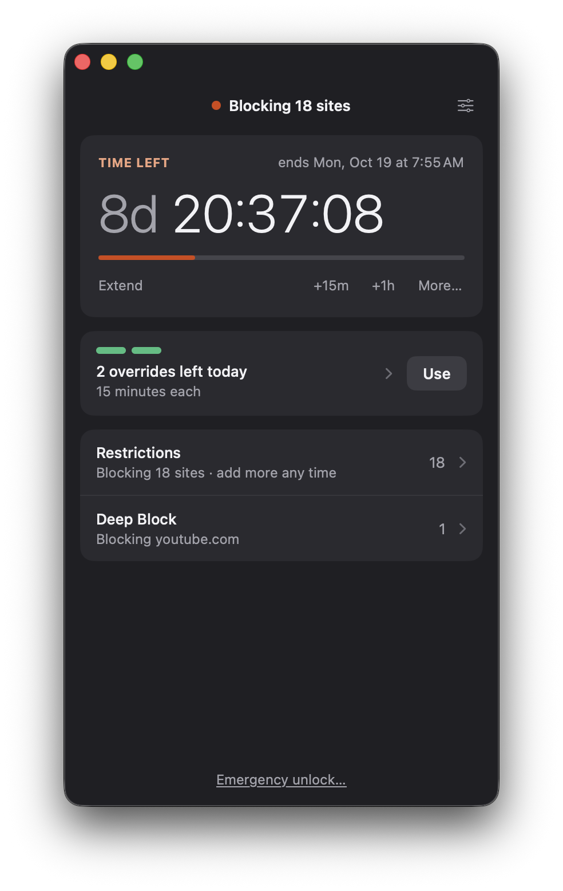

I love the application SelfControl. It has rescued countless hours that would have otherwise been misspent on the internet. 

Unfortunately, SelfControl has one major flaw: it is easily defeated. I spent many productive years purposely avoiding information about how to defeat it. But once you know, you know. (If you don't know and don't want to know, consider not reading any further.)

This fork fixes the flaw and adds a few other features I have long wanted. Because this fork was built by AI, its updates will not be submitted for inclusion in the main app. Nevertheless I am publishing it in case others find it or its ideas useful. 

# How I use SelfControl
My use of SelfControl is perhaps idiosyncratic. The design of the app suggests the typical use case is to turn on blocks for relatively short periods of time to promote focused work. But I don't want to have to exert the willpower to start a block every time I need to focus. The reason I use an app called SelfControl is that I lack self-control. 

Instead, I like to run multi-week blocks so that blocking is on by default when I start my day. Because my blocks are so long, I do not shut off access to email or other required (but often distracting) communication tools. 

Therefore, I want a baseline long-term block that cuts off most of my distractions, but also the ability to temporarily adjust the active block in either direction:

1. A limited number of configurable overrides allow me to pause the block for a few minutes when I need to check something or just want a short break.
2. Deep block sessions allow me to layer even more restrictions on top of the baseline block when I want to tune out all possible distractions.

Details below.

# New features
## No more easy defeat
The main version of SelfControl uses the system clock to determine when a block should end. You can trick it by rolling the clock forward. 

This version uses an internet clock to determine when a block should end. Changing the system clock does not affect the block duration.

**What if I'm not connected to the internet when my block ends?**
The block stays on until SelfControl can check the time again. It retries in the background, and the internet time servers stay reachable even during a block, so the block lifts within a few minutes of you getting back online. Being offline can make a block run long, but never short.

**What if I'm not connected to the internet when my block starts?**
That's fine. The block starts right away and counts down on the Mac's internal timer, which keeps running through sleep and ignores changes to the system clock. The first time you're back online, SelfControl checks the real time and pins the block to it. One wrinkle: if you shut the computer down before that first check, the time it spends powered off doesn't count, so the block runs that much longer.

**What if I literally can't connect to the internet ever again?**
Then the block never ends on its own. In this scenario, the new Emergency Unlock feature is your friend. If you've turned emergency unlock off, you're committed until you get back online.

**What if I block the internet time servers?**
You can't block time servers using SelfControl. If you add a time server to your restrictions, it is quietly dropped from the list. Time requests are always let through the block, even in allowlist mode. This prevents you from accidentally creating a permanent block.

You can block time servers in other ways, say with a firewall or at your router. As with turning off your internet connection, blocking the clock can only make a block longer.

**What about various other ways I can try to hack the block?**
The app has been hardened against some other shenanigans, but I'm sure there are ways to defeat it if you are determined enough. My main goal was to prevent the date-shift trick because it was trivially easy. 
## Temporary overrides
With a multi-week block enabled, SelfControl can be a little too severe for my taste. I want to keep my computer distraction free for the large majority of time that I am using it, but I don't see harm in taking a ten-minute break every once in a while.

My version allows you to temporarily lift a block using configurable overrides. Choose the number of daily overrides and their duration. Set the number of overrides to zero to disable.

<p align="center"></p>

You can decrease the number or length of allowed overrides mid-block. You can't increase them until the block ends.
## Temporary deep blocks
The reason I am able to set two-week blocks is that I'm not blocking everything, or even most things. I am just blocking the most distracting, least necessary websites (in other words, the websites I most want to spend time on). 

But sometimes I want a deeper block. I want to cut off email, Slack, and every other distraction while I focus on a single important task. 

Enter deep blocks. These are additional short-term blocks that can be layered on top of a block already in progress. I use these for short, pomodoro-like bursts of focused work.

<p align="center"></p>

## Emergency unlock
Surprisingly, my multi-week blocks have never been a problem. Not once have I have encountered an urgent need to end a block mid-cycle. 

Still, I understand that it could happen. So now there is an optional failsafe: if you desperately need to end a block, you can type a sequence of several hundred random numbers. The task is onerous enough that you are unlikely to do it on a sudden whim. But it is tractable enough that you can plausibly get through it in ten minutes or so. 

<p align="center"></p>

Also, you can turn off the emergency unlock option if you don't trust yourself with it.
## Respect for subdomains
I sometimes want to block one subdomain but not another. The app now better respects subdomain-specific entries in the blocklist. Use the bare domain if you want to block all traffic from a domain:

```text
google.com
substack.com
```

This block list will cut off all traffic to Google and Substack, including Google search, Gmail, Maps, etc. If you want to be more focused in your block, you can do this instead:

```text
news.google.com
someblog.substack.com
```

This will just restrict access to the listed subdomains.

One caveat: a subdomain entry is easier to slip past than a whole-domain entry. When you block a bare domain, the app blocks it twice: by name, and at the firewall by the addresses of the site's servers. A subdomain entry is blocked by name only, because subdomains often share servers with the rest of the site, and blocking those addresses would also cut off the subdomains you wanted to keep.

That gap matters for sites that save themselves in your browser so they can work offline. The New York Times is one. Blocking `www.nytimes.com` (to keep `cooking.nytimes.com` open) doesn't work in Chrome. On your first visit, the site installs a background script in the browser, and that script redraws the front page from a saved copy, never looking up the blocked name. Fresh articles then load from other NYT servers that aren't blocked. News sites, social media, and anything that behaves like an app (works offline, can be installed, sends notifications) are the most likely to get through this way.

For those sites, block the whole domain (`nytimes.com`). If you really need a subdomain-only block, remove the site's saved script before the block starts: in Chrome, go to `chrome://serviceworker-internals` and unregister the site. It comes back the next time you visit, so you'd need to repeat this before each block.
## UI refresh
The main version of SelfControl has a functional, simple user interface. It gets the job done. My version maintains the overall simplicity, but unifies the controls in a single window and puts a bit of gloss on them.

<p align="center"></p>

One nice convenience feature: you can now edit the maximum block duration directly in the settings pane.
## Possible future features
Originally I had planned to allow for scheduled blocks that would restrict the internet at certain times of day or days of week. This seemed like a useful elaboration for the way that I use SelfControl to manage my general workweek. But once I made all the changes above, the schedule option feels considerably less urgent. 

# Installing

There's no prebuilt download. You build it yourself, signed with your own (free) Apple ID. You need a Mac on macOS 13 or later.
## Ask AI to do it
If you use [Claude Code](https://claude.com/claude-code) or [OpenAI Codex](https://openai.com/codex/), you can paste this request into it:

```text
Please build and install the SelfControl fork from https://github.com/arstein/selfcontrol
on this Mac. Follow the "Build it yourself" steps in its README. Sign it with my own
Apple ID's Personal Team, and ask me before doing anything that needs my password or
admin rights.
```

## Build it yourself

1. Install Xcode from the App Store, then run `xcode-select --install`.
2. Install CocoaPods: `brew install cocoapods` (or `sudo gem install cocoapods`).
3. In Xcode, open Settings › Accounts and sign in with your Apple ID. This creates a free "Personal Team".
4. Find your team ID: run `security find-certificate -c "Apple Development" -p | openssl x509 -noout -subject` and look for `OU=XXXXXXXXXX` (the code in parentheses after your name is not the team ID). If it finds no certificate, open the project in Xcode once and let it create one.
   - If the certificate shows as not trusted, install Apple's WWDR G3 intermediate certificate from <https://www.apple.com/certificateauthority/>.
5. Clone and build:
   ```sh
   git clone https://github.com/arstein/selfcontrol.git
   cd selfcontrol
   pod install
   xcodebuild -workspace selfcontrol.xcworkspace -scheme SelfControl \
     -configuration Release -derivedDataPath build \
     -allowProvisioningUpdates DEVELOPMENT_TEAM=<your team ID> build
   ```
   Replace `<your team ID>` with the ID from step 4; the project file has mine.
6. Install it: `cp -R build/Build/Products/Release/SelfControl.app /Applications/`
7. Open SelfControl. When macOS asks, allow its background helper in System Settings › General › Login Items.

## If the original SelfControl was installed
The original app installed its helper in an older way, under the same name, and deleting the app doesn't remove it. Until it's removed, macOS won't register this fork's helper, and SelfControl keeps asking you to turn it on in Login Items without ever appearing there. Make sure no block is running (`grep "SELFCONTROL BLOCK" /etc/hosts` prints nothing), quit SelfControl, then run:

```sh
sudo launchctl bootout system/org.eyebeam.selfcontrold
sudo rm -f /Library/LaunchDaemons/org.eyebeam.selfcontrold.plist /Library/PrivilegedHelperTools/org.eyebeam.selfcontrold
```

Then restart the Mac, open SelfControl, and approve the helper when asked.
## Copying a build to another of your Macs

A build signed with your Apple ID runs on your other Macs too. Copy `SelfControl.app` into `/Applications` on the other Mac, then run:

```sh
xattr -dr com.apple.quarantine /Applications/SelfControl.app
```

This is needed because the app isn't notarized by Apple. Then open it and allow the helper as in step 7. Free signing certificates last about a year, so rebuild after that.

# About
SelfControl is a free and open-source application for macOS that lets you block access to distracting websites, your mail servers, or anything else on the Internet. Just set a period of time to block for, add sites to your blocklist, and click "Start Block". Until that timer expires, you will be unable to access those sites—even if you restart your computer or delete the application.
## Credits
The original SelfControl was developed by [Charlie Stigler](http://charliestigler.com), [Steve Lambert](http://visitsteve.com), and [others](https://github.com/SelfControlApp/selfcontrol/graphs/contributors). For the official app, go to [selfcontrolapp.com](https://selfcontrolapp.com).
## License
SelfControl is free software under the GPL. See [this file](./COPYING) for more details. This fork is under the same license.
